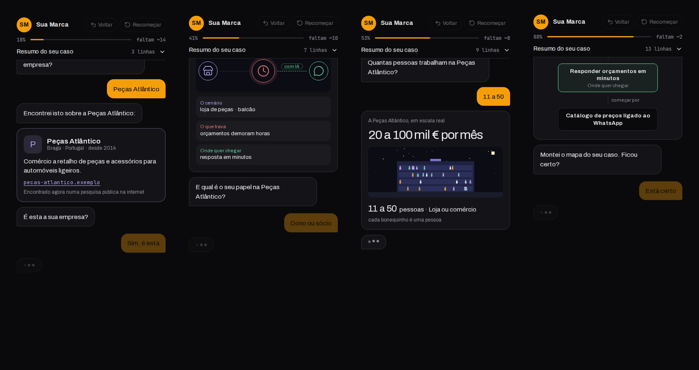

# Form Dinâmico

**O formulário que conversa.** Uma pergunta de cada vez, como num chat. Enquanto a pessoa responde, a IA pesquisa a empresa dela na internet, anota o problema enquanto ela escreve, cria uma pergunta sob medida e desenha o mapa do caso. No fim, você recebe um lead qualificado por e-mail, com tudo o que precisa para a primeira conversa.

[](LICENSE)


<p align="center">
  
</p>

<p align="center"><sub>Dados de exemplo. A empresa e as respostas são fictícias.</sub></p>

<p align="center">
  <a href="#começo-rápido-com-o-claude-code"><b>Montar com o Claude Code</b></a> &nbsp;·&nbsp;
  <a href="#começo-manual"><b>Montar sem LLM</b></a> &nbsp;·&nbsp;
  <a href="docs/PUBLICAR.md"><b>Publicar</b></a> &nbsp;·&nbsp;
  <a href="docs/PHP.md"><b>Alojamento PHP</b></a>
</p>

Formulário comprido cansa e filtra mal. A pessoa desiste no meio, ou responde qualquer coisa para acabar logo. Este aqui é a versão aberta do diagnóstico que roda no site do [@johnnyhelder.ia](https://www.instagram.com/johnnyhelder.ia/), pensada para tráfego pago. A pessoa sente que está avançando e que foi ouvida, e você recebe menos contatos frios.

## O que faz

- **Uma pergunta de cada vez, como num chat.** Balões, "digitando…", opções em botões, barra de progresso com "faltam ~N".
- **Pesquisa a empresa na hora.** A pessoa escreve o nome, o formulário pesquisa na internet e mostra o cartão com o que encontrou (cidade, país, o que faz, site). "É esta a sua empresa?" Se for, o país já fica respondido e os segmentos mais prováveis sobem para o topo. Só aparece quando a pesquisa tem confiança; na dúvida, segue sem cartão.
- **Anota enquanto a pessoa escreve.** No campo "o que você quer resolver", as anotações aparecem ao vivo. Ao enviar, surge o cartão do cenário (como é hoje, o que trava, onde quer chegar).
- **A empresa em escala real.** Um desenho em pixel com um bonequinho por pessoa da equipe.
- **Uma pergunta que ninguém escreveu.** A IA cria uma pergunta a partir do que a pessoa contou, com respostas prováveis e um palpite.
- **O mapa do caso.** Um fluxograma com o problema, as causas, o objetivo e o primeiro passo. A pessoa confirma ou pede um ajuste, e o mapa redesenha.
- **Painel "Resumo do seu caso"** que se escreve sozinho, e um radar que muda a cada resposta.
- **Voltar e Recomeçar** a qualquer momento.
- **Grava cada resposta**, não só as conversas concluídas. `npm run leads` mostra onde as pessoas desistem.
- **Aviso a cada lead** por e-mail, e opcionalmente no Telegram ou num webhook (n8n, Make, CRM), com todas as respostas, o mapa e a origem do anúncio (`utm_*`).
- **Modo de teste.** Abra com `?teste=1`. O pedido fica marcado, o aviso vai com [TESTE] e `npm run leads -- apagar-testes` limpa tudo.
- **Pergunta com educação quando algo parece engano.** "Só para confirmar, mais de 200 convidados com um investimento até 300 €?" A pessoa corrige ali mesmo, ou confirma e o pedido chega marcado para rever à mão.
- **Na língua do cliente.** pt-BR, pt-PT, espanhol ou inglês, com a IA a escrever na mesma língua.
- **Funciona sem IA.** Sem chaves, ou se a IA falhar, a conversa segue com as perguntas fixas.
- **Proteção contra robôs e abuso.** Cloudflare Turnstile (opcional, grátis), campo escondido, tempo mínimo, limite de chamadas por pessoa e teto diário de chamadas à IA.

## Começo rápido com o Claude Code

Você precisa de [Node.js 20.9 ou mais novo](https://nodejs.org), [git](https://git-scm.com) e [Claude Code](https://claude.com/claude-code).

```bash
git clone https://github.com/johnnyhelder/form-dinamico.git meu-form
cd meu-form
npm install
claude
```

E diga

> me ajuda a configurar para o meu negócio

A LLM lê o `CLAUDE.md`, pergunta o que você vende e o que precisa saber de quem responde, reescreve as perguntas com você, e conduz as chaves e a publicação, uma etapa de cada vez. Ela nunca pede para você colar chave no chat.

Usa outra LLM (Codex, Cursor, Gemini CLI, Copilot)? As instruções moram no `AGENTS.md`, que essas ferramentas leem sozinhas.

## Começo manual

```bash
git clone https://github.com/johnnyhelder/form-dinamico.git meu-form
cd meu-form
npm install
npm run dev
```

Abra http://localhost:3000. A conversa já funciona sem nenhuma chave, só sem os extras de IA.

1. **Edite o `formulario.ts`.** É o único arquivo que você precisa mudar (perguntas, opções, textos, cor e o que a IA sabe do seu negócio). Os tipos de passo estão explicados em `src/lib/tipos.ts`. Depois, `npm test`.
2. **Grave as chaves** com `npm run chave -- NOME` (ela não aparece na tela). Veja [docs/CHAVES.md](docs/CHAVES.md).
3. **Confira** com `npm run verificar`.
4. **Publique** na Vercel. Veja [docs/PUBLICAR.md](docs/PUBLICAR.md).

## Os tipos de passo

| Tipo | O que a pessoa vê |
|---|---|
| `texto` | Uma linha para escrever (nome, por exemplo). |
| `empresa` | O nome da empresa, com pesquisa na internet e o cartão "É esta?". |
| `escolha` | Opções em botões. Pode deixar escrever outra. As opções podem depender de respostas anteriores (faixas em € ou R$, por exemplo). |
| `varias` | Marcar várias e tocar em "Pronto". |
| `problema` | Texto livre com anotações ao vivo e o cartão do cenário. |
| `escala` | Tamanho da equipe, com o desenho em bonequinhos. |
| `data` | Calendário, com "Ainda não sei" e, se quiser, a resposta na hora se a data está livre. |
| `sugestao` | A IA escolhe do seu catálogo os serviços que encaixam, com o porquê, e a pessoa confirma. |
| `resumo` | Uma frase a resumir o pedido, com "Está certo" e "Corrigir". |
| `extra` | A pergunta criada pela IA. |
| `mapa` | O mapa do caso, para confirmar ou ajustar. |
| `email`, `telefone` | O contato, no fim. |

Cada negócio tem as suas perguntas. O `formulario.ts` traz um diagnóstico para uma agência de IA; `exemplos/eventos.ts` traz pedidos de orçamento de eventos, em PT-PT. Qualquer passo aceita `pular` (para não perguntar o que já se sabe, ou para ramos) e textos que usam as respostas anteriores (`(r) => \`E onde fica a ${r.empresa}?\``).

## Quanto custa

Cêntimos por lead. A IA (Claude Haiku) custa menos de 1 cêntimo por conversa completa, a pesquisa da empresa uns 2 créditos do Firecrawl, e o banco (Neon) e o e-mail (Resend) cabem nos planos grátis. Detalhes em [docs/CUSTOS.md](docs/CUSTOS.md).

## Como foi pensado

- **Código para o que tem resposta certa, IA para o resto.** Faixas, países, prazos são botões. A IA entra onde a pessoa escreve com as palavras dela, e para mostrar que entendeu.
- **A IA nunca trava a conversa.** Ela trabalha antes de a pessoa precisar dela (a pergunta extra prepara-se enquanto a pessoa responde às outras). Se não chegar a tempo, o passo some.
- **Respostas da IA em formato fechado.** Saída estruturada com JSON Schema, conferida de novo antes de usar. A página nunca interpreta texto livre da IA.
- **O link da empresa só aparece se veio mesmo da pesquisa.** A IA não inventa sites.
- **A IA não recebe nome, e-mail nem telefone.**

## Site em PHP, WordPress ou cPanel?

Também dá. `npm run exportar` gera uma pasta com a mesma página e três ficheiros PHP pequenos (só precisam de `curl` e `json`). Envia por FTP e as chaves ficam num ficheiro fora da parte pública. Passo a passo em [docs/PHP.md](docs/PHP.md).

## Stack

Next.js (App Router, TypeScript), Postgres no [Neon](https://neon.tech), e-mail pelo [Resend](https://resend.com), IA pelo [Claude Haiku](https://platform.claude.com), pesquisa pelo [Firecrawl](https://firecrawl.dev). Publicação na [Vercel](https://vercel.com).

## Licença

MIT. Use, adapte e venda a implantação para os seus clientes à vontade.

Feito por [Johnny Helder](https://www.instagram.com/johnnyhelder.ia/).
